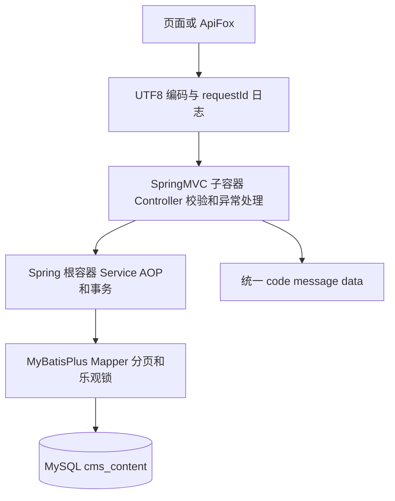
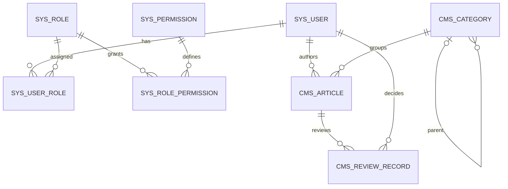
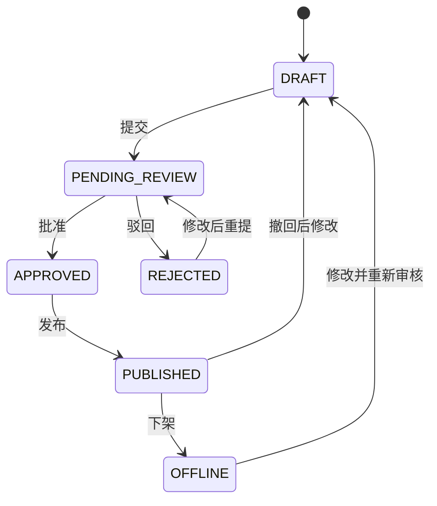

# 架构与数据库初稿

## 请求与容器

SpringConfig 只扫描业务、公共组件；SpringMvcConfig 只扫描 Controller 和 Advice。PersistenceConfig 使用 MP 专用 MybatisSqlSessionFactoryBean。WAR 中只有生产代码，本地工具和验证实体位于 src/test。

## 数据库关联

SYS_OPERATION_LOG 独立保留操作者ID与名称快照，避免账号变化影响历史。图中是关联概览，字段、索引和约束以 sql/init.sql 为准；后续由各模块作者完善字段设计图。

## 内容流程

该图是模块共同设计，当前基础工程只定义状态枚举，具体状态服务尚待杨程与袁运轩实现。
