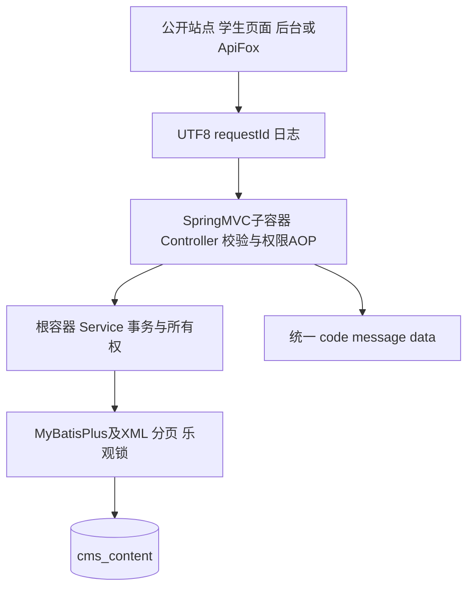
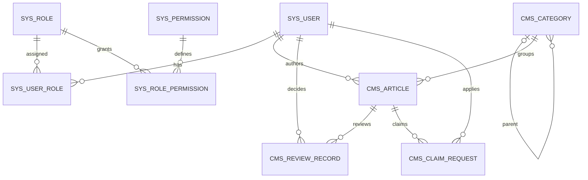
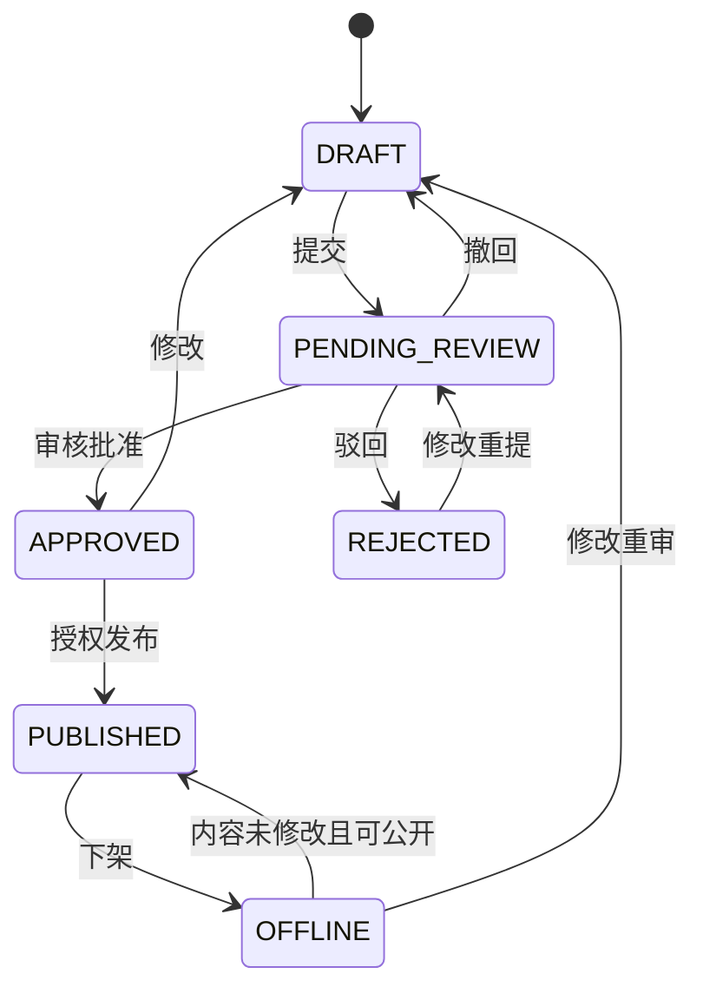
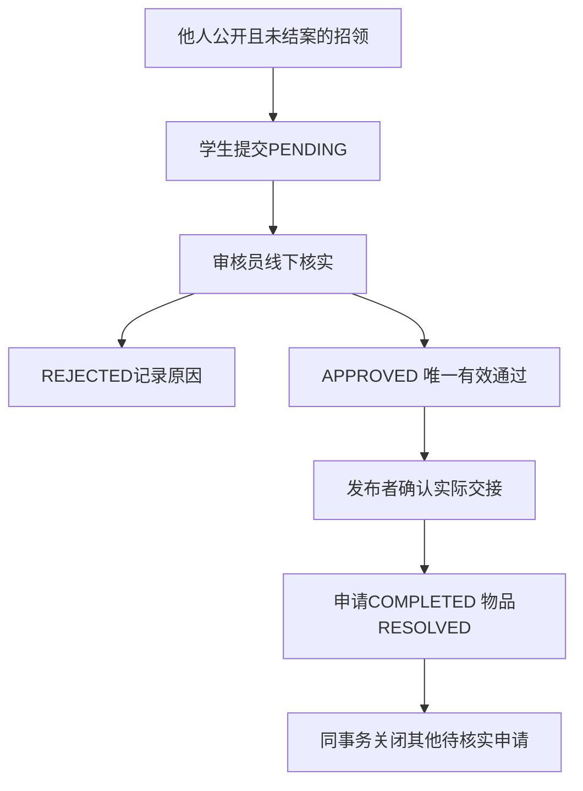

# 校园失物招领架构与数据设计

## 请求与容器

两个容器分别启用 AOP；Service 在根容器，Controller 与 Advice 在 MVC 子容器。实际业务登录权限由郭金滔接入。MP 专用工厂加载 mapper XML；测试与数据库工具不打入 WAR。

## E R 关联

十张业务及关联表。SYS_OPERATION_LOG 独立保存操作者快照，避免账号变化影响历史。表字段、约束与索引以 sql/init.sql 和增量脚本为准。

## 内容状态设计

## 认领与结案设计

上面的图定义业务需求，状态服务仍由杨程与袁运轩实现。基础工程已提供枚举、认领约束和基础回归测试，不声称已经实现整条业务流程。
